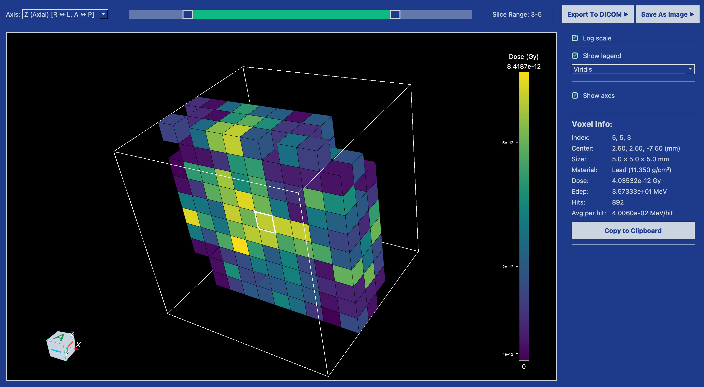
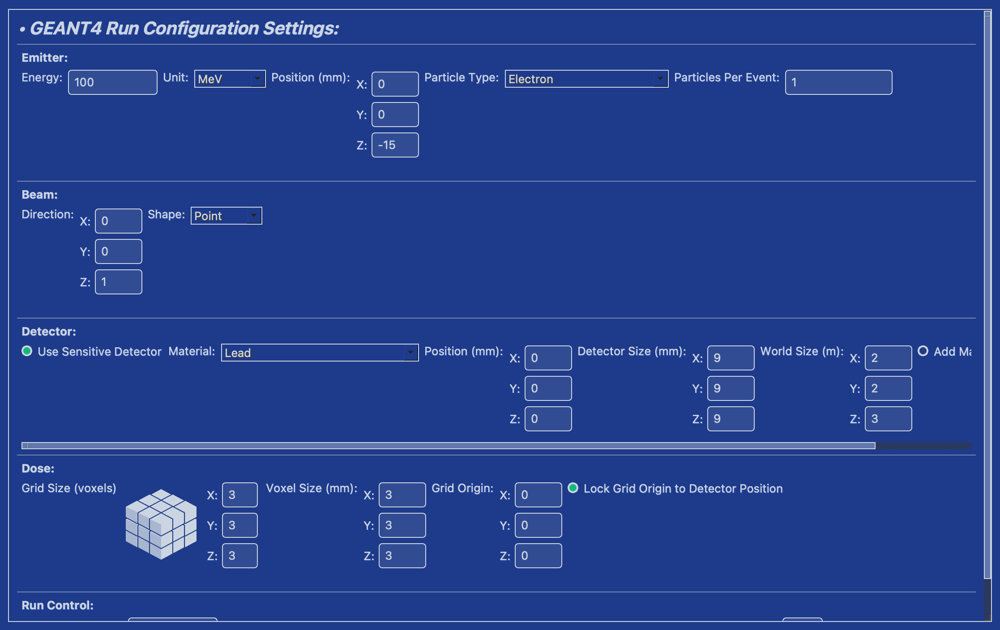
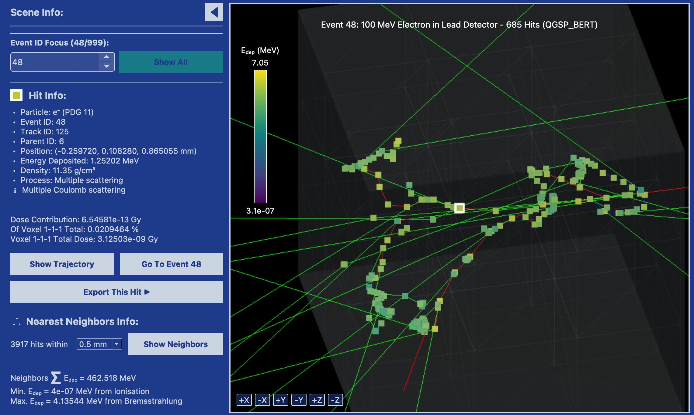

# Beam Research Toolkit

**A desktop GEANT4 app for particle-beam work - without compiling GEANT4.**

Run custom simulations & export focused data insights. All without writing one line of code.

[Download](https://qirexscientific.com/downloads.html) · [Website](https://qirexscientific.com/) · [Pricing](https://qirexscientific.com/#subscribe) · [Issues](../../issues) · [Support](mailto:support@qirexscientific.com)

<p align="center">
  
</p>
<p align="center"><sub>3D dose viewer — sliced voxel grid from a Beam run</sub></p>

Beam Research Toolkit is the flagship product of [Qirex Scientific](https://qirexscientific.com/). It is a native desktop application (Linux AppImage / macOS Apple Silicon) that ships with a **managed GEANT4 instance**. You configure a run, simulate a beam in matter, inspect events and dose, and export files your lab already uses.

This repository is the **public home** for Beam: documentation, screenshots, release pointers, and an issue tracker. The application source is private. That is intentional.

---

## Who this is for

| You | Why Beam exists |
|---|---|
| **Just discovered particle physics** | You can see a beam interact with matter without a semester of compilers, CMake, and physics-list folklore. |
| **Student or instructor** | Labs and projects that should be about showers and dose, not toolchains. |
| **Working physicist / engineer** | Prototype a geometry, check a dose map, export ROOT or VTK — without writing glue code for every look at the data. |

If you already know GEANT4: Beam is the workstation layer you wish started on day one.  
If you do not: GEANT4 is the toolkit CERN and labs use to simulate how particles travel through detectors, shielding, and tissue. Beam runs that engine for you.

---

## What you can do in v1.1.0

- Configure and run a beam simulation with embedded GEANT4 — no separate install
- Full geometry customization from Geant4 primitives for the detector and secondary objects
- Complete material choice (NIST search, custom compositions, density overrides)
- Any Geant4 particle type, including ions
- Detector and object rotation; uniform magnetic fields on scene objects
- Live Configuration Previewer so you can see the setup before running
- Secondary objects that can be renamed, cloned, or deleted
- Redesigned configuration screen with collapsible sections
- Explore events in 3D with nearest-neighbor filtering, event isolation, and clearer hit details (including creator process)
- Inspect energy deposition with histograms plus 2D, ISO, and 3D dose viewers
- Export in one click to **DICOM RT Dose, CSV, JSON, ROOT, ParaView, VTU**
- Save and reload configurations; automated workflows and production color maps
- Significantly faster simulation runs

<p align="center">
  
  &nbsp;
  
</p>
<p align="center"><sub>Run configuration · Interactive simulation explorer</sub></p>

---

## Download

Official builds live on the Qirex site. Do not expect a binary attached to every GitHub release unless we say so there.

| Platform | Build | Link |
|---|---|---|
| Linux x86_64 | AppImage | [Download Linux v1.1.0](https://downloads.qirexscientific.com/releases/linux/1.1.0/Beam_Research_Toolkit-1.1.0-x86_64.AppImage) |
| macOS Apple Silicon | Notarized `.app` in zip | [Download macOS v1.1.0](https://downloads.qirexscientific.com/releases/mac/1.1.0/Beam_Research_Toolkit-macos-arm64.zip) |

Requirements and GPG / Gatekeeper notes: [qirexscientific.com/downloads.html](https://qirexscientific.com/downloads.html)

**Linux (short path)**

```bash
chmod +x Beam_Research_Toolkit-1.1.0-x86_64.AppImage
./Beam_Research_Toolkit-1.1.0-x86_64.AppImage
